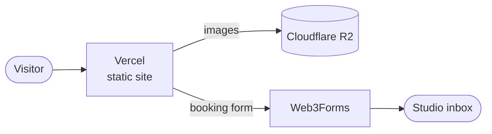

<div align="center">

# ROLLIN REALMS

**Crafting Stories, Transcending Boundaries.**

Website for Rollin Realms, an independent & commercial film and media production house in Dhaka, Bangladesh.

[](https://rollinrealms.vercel.app)


<!-- Add a screenshot: save it as docs/preview.png, then uncomment the line below.

-->

</div>

---

## What's inside

A single-page cinematic portfolio and booking site: dark "obsidian" look, cinema-red accents, offset-frame imagery.

| | |
|---|---|
| **Sections** | Hero, About, Mission, Vision, Services, Commercial Snaps, Reel Snaps, Originals, Events, Clients, Team, Portfolio, Wall of Fame, Contact |
| **Shared lightbox** | Arrow buttons, keyboard arrows, touch swipe, `N / total` counter, fade transition and neighbour preloading, used by the galleries and snap grids |
| **Book Service flow** | The header button and each service's "Book This Service" button jump to the booking form, with the project format preselected |
| **Booking form → email** | Submissions land in a normal inbox, no database or dashboard to check. A hidden honeypot field blocks most bots |
| **Navigation** | Floating header with scroll-spy highlighting and a mobile drawer |
| **Performance** | No backend, lazy-loaded images below the fold, ~90 KB gzipped JS |

## How it fits together



There is no server and no database. The site is static files on Vercel, media is served from Cloudflare R2, and the booking form posts straight to Web3Forms, which emails the studio.

## Quick start

```bash
git clone https://github.com/samin-isnotavailable/rollin-realms-website.git
cd rollin-realms-website
npm install
cp .env.example .env.local   # add your Web3Forms key (see below)
npm run dev
```

| Script | What it does |
|---|---|
| `npm run dev` | Dev server |
| `npm run build` | Production build into `dist/` |
| `npm run preview` | Serve the production build locally |
| `npm run lint` | Type check (`tsc --noEmit`) |

## Environment variables

| Variable | Required | Purpose |
|---|---|---|
| `VITE_WEB3FORMS_KEY` | Yes, for the booking form | Access key from [web3forms.com](https://web3forms.com). Submissions are emailed to the address you registered |

Vite reads env vars at **build time**. If you add or change one on Vercel, redeploy.
The key is visible in the public JS bundle. That is normal for Web3Forms; it can only send mail to your inbox.

## Booking form setup

1. Go to [web3forms.com](https://web3forms.com), enter the email that should receive bookings, and confirm it.
2. Copy the access key they email you.
3. Put it in `.env.local` as `VITE_WEB3FORMS_KEY=...` (local) and in Vercel's Environment Variables (production).
4. Submit the form once and check the inbox, including spam the first time.

The recipient can be changed later in the Web3Forms dashboard with no code change.

## Deploy

1. Push to GitHub.
2. On [vercel.com](https://vercel.com): **Add New Project**, pick this repo. Vite is detected automatically (build `npm run build`, output `dist`).
3. Add `VITE_WEB3FORMS_KEY` under **Environment Variables** before the first deploy.
4. Deploy. Every push to `main` redeploys automatically.
5. Optional: add a custom domain under **Settings → Domains**.

## Editing content

Almost everything lives in one file: [`src/data/content.ts`](src/data/content.ts). Text, lists, team, services, awards and image URLs are all there.

Images are served from Cloudflare R2 through `MEDIA_BASE_URL`. To replace an image, upload a new file to the bucket with the **same filename**; no code change needed.

> Heads up: the default `r2.dev` URL is intended for development and is rate-limited. For heavy production traffic, connect a custom domain to the bucket (e.g. `cdn.rollinrealms.com`) and update `MEDIA_BASE_URL`.

## Project structure

```
├── public/                 logo files
├── src/
│   ├── components/         one file per page section
│   │   ├── MediaLightbox.tsx   shared lightbox (swipe, arrows, counter)
│   │   ├── Contact.tsx         contact cards + booking form
│   │   └── ...
│   ├── data/content.ts     all site content and media URLs
│   ├── App.tsx             page assembly, scroll-spy, lightbox state
│   └── index.css           global styles and animations
├── .env.example            required environment variables
└── vite.config.ts
```

## Tech

React 19 · TypeScript · Vite · Tailwind CSS v4 · lucide-react · Bricolage Grotesque

## License

© 2022–2026 Rollin Realms. **All rights reserved.**

The source is public for viewing only. The code, logos, images, text and other content may not be copied, reused or redistributed without written permission.

---

<div align="center">

Website designed & built by [Mubarrat Ahmed Samin](https://github.com/samin-isnotavailable)

</div>
